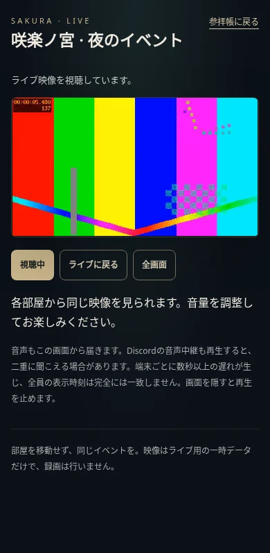

# イベント映像の共通視聴

OBSで送った映像と音声を、在籍中のメンバーが `/visit/event` で視聴します。各VCから同じURLを開く形です。Discord内の画面共有欄へBOTが映像を出す機能ではありません。既存のイベント音声中継は変更しません。

## 構成

```text
OBS ── RTMPS（TLS検証）── MediaMTX
                            │ Docker内のHLS
                            ▼
                      社務所Webの認証中継
                            │ HTTPS / 同一オリジン
                            ▼
                      Discord認証した視聴者
```

MediaMTXは映像を変換せず、そのままライブ用HLSにします。視聴URLは認証付き経路だけを返し、生のHLS/管理APIを公開しません。視聴ページを開いただけでは再生せず、「視聴を始める」を押して開始します。Safariの対応環境では標準プレーヤー、それ以外の対応環境では同梱のhls.jsを使います。

## 視聴と運営の操作

1. 参拝帳から「イベント配信」を開くか、共通URL `/visit/event` を開きます。
2. Discord認証後、サーバー在籍を確認します。退会済み・BOT・DB上の非在籍は利用できません。Discordの確認に失敗したときも映像を渡しません。
3. 宮司・神職は「運営の配信操作」でイベント名と案内を入れ、「新しいイベントを準備」を押します。
4. 「OBSの接続情報を表示」でサーバーとストリームキーを取得し、OBSへ入力します。鍵は初期状態でマスクし、本人の操作でコピーできます。60秒後・画面非表示・ウィンドウを離れたときに画面から消します。
5. OBSから接続してから「視聴を開始」を押します。配信元の接続を確認できない間は開始しません。
6. 視聴者は「視聴を始める」を押します。音量・一時停止は動画の標準操作、「ライブに戻る」は再接続、「視聴を止める」は映像取得の停止です。端末が対応すれば全画面にもできます。
7. 「イベントを終了」で新しい視聴・配信接続を拒否し、配信元のRTMP接続をAPIから切断します。API障害でも視聴と鍵は先に停止し、OBSでの手動停止を案内します。視聴画面は5秒ごとの状態確認で媒体を破棄します。既に端末へ渡った映像を回収することはできません。

イベントは準備から最長6時間で失効します。以後の媒体取得・配信認証は即座に拒否し、30秒ごとの処理で接続切断も試みます。次のイベントは新しいIDと鍵になります。終了したイベントは再開できません。

Discordの音声中継と、この画面の音声を同時に聞くと二重になることがあります。映像と音声をこのページで一緒に聞く運用を基本にしてください。数秒以上の遅延があり、端末間の厳密な同期はしません。ビンゴ等の公正な締切を映像の再生時刻だけで決めないでください。

## 導入の前提

新規サーバーの契約や、実際のVPS・DNS・証明書・ファイアウォール変更は、このリポジトリの変更だけでは行われません。最初の構成は社務所Webと同じVPSへ任意のComposeサービスを足す形です。設置先・想定人数・回線容量を確かめてから起動してください。

- 外から到達できる、配信用ホスト名と1936/TCP。通常のCloudflareのHTTPプロキシはRTMPSの入口として使いません。視聴者が使うのは既存のHTTPSです。
- そのホスト名で信頼されるTLS証明書と秘密鍵。証明書のSANが配信先の名前と一致し、更新とMediaMTXの再起動まで運用してください。本番で自己署名証明書の検証を省略しません。
- 証明書ファイルを置く専用ディレクトリ。ファイル名を `server.crt` と `server.key` にし、運営以外が秘密鍵を読めない権限にします。リポジトリへ入れません。
- 64文字のランダムな16進数など、十分に長い配信認証用の秘密。最低43文字です。既存のBOTトークンを流用しません。

`.env` に次を設定します。実際の値をPR・会話・画面見本・ログへ貼らないでください。

```dotenv
EVENT_STREAM_SECRET=<ランダムな秘密。例としての文字をそのまま使わない>
EVENT_STREAM_INGEST_URL=rtmps://stream.example.com:1936/event
EVENT_STREAM_TLS_DIR=/srv/event-stream-tls
```

秘密の作成には、管理する端末で `openssl rand -hex 32` などを使えます。出力は安全に保管し、ここへ送る必要はありません。Webだけを起動して配信設定をしない場合は機能を準備中として表示し、既存ページは使えます。

既存の `COMPOSE_FILE` にローカル用や読み上げ用の追加ファイルがある場合、それを外さず末尾へ `docker-compose.events.yml` を追加します。通常のドメイン構成なら次の指定です。

```sh
docker compose -f docker-compose.yml -f docker-compose.events.yml up -d web event-media
```

Caddyfileも更新する場合は、Caddyを再読込するか作り直します。`/event-stream/auth` は外部から404とし、MediaMTXからDocker内の `web:3000` へだけ認証を問い合わせます。

自動更新でもこの追加構成を維持するため、既存の値を確認したうえで `.env` の `COMPOSE_FILE` に追加ファイルを残します。既存の指定を置き換えて削除しないでください。

別の配信サーバーへ分ける場合は、Webの `EVENT_STREAM_MEDIA_URL` と `EVENT_STREAM_API_URL`、MediaMTXの `authHTTPAddress` の往復が必要です。最初の追加Composeは同じDockerネットワーク用であり、別VPSへそのまま移せる構成ではありません。プライベートネットワーク/VPNとファイアウォールを用意し、外部ネットワーク越しならHTTPSを使います。HLS/管理APIや、Webの内部認証経路を無認証でインターネットへ公開しないでください。

## OBSの目安

- 配信先：カスタム。サーバーとキーは運営画面から取得します。
- 映像：H.264、720p/30fps程度から。キーフレーム間隔2秒、まず2〜3Mbps。
- 音声：AAC、128kbps程度。
- ホスト名と証明書が一致し、TLS検証が成功する接続を使います。

MediaMTXはトランスコードしません。元の映像形式が端末で再生できなければ視聴できません。回線に合わせた自動の多画質変換もありません。OBS側でビットレートを調整してください。

## 帯域と制限

3Mbpsの映像を50人が見ると、音声等を除いた下り送信だけで約150Mbps、1時間で約67.5GBになります。100人なら約300Mbpsです。実際は音声・HTTP等が増えます。VPSの契約上限・月間通信量・他のBOT/Webへの影響を見て決めてください。

- 追加サービスはメモリー512MB/CPU1/pid128の上限付き。これは収容人数の保証ではありません。
- 媒体の同時取得は1人8本、Webプロセス全体512本までです。上限時は429を返します。
- 媒体1件は最大12MB、プレイリストは256KB、取得は15秒までです。
- 在籍確認はGETだけ30秒まで共有し、運営操作では毎回確認します。Discord上だけの退会を反映するまで最大約30秒かかる場合があります。DBの退会状態とセッションは媒体取得ごとに確認します。
- 停止や失効後も、既に受信した映像・スクリーンショットの持ち出しを防ぐものではありません。
- 録画・再放送・視聴履歴・外部解析送信・Discordへの自動投稿は実装しません。ライブ再生用の短い映像区切りはメモリーにだけ保持します。

## 素材と検証

- MediaMTX：1.15.6、`sha256:2001b73159ec146478df64d5fe5a973ae0d978a1648138cbbc6bc6f9c4cc9c82` に固定。設定は `deploy/event-stream/mediamtx.yml`。
- hls.js：1.6.15の `dist/hls.min.js` を同梱。取得元 `https://cdn.jsdelivr.net/npm/hls.js@1.6.15/dist/hls.min.js`。SHA256は `413a83e2bb0c77ed0bf0be105d539d17ef45dfd984a0b13ecd3b14a901383938`。Apache-2.0と元の著作権表示を `src/web/public/vendor/` に保存しています。
- ローカルで生成したH.264/AACを、試験用の信頼証明書を検証したRTMPSで送信。Chromium/WebKitで640×360の映像が進むこと、再接続、非表示停止、通常4幅の44px操作面、匿名の媒体拒否を確認しました。
- 実際のAPI切断、停止済みの鍵と映像の拒否、直接HLS/直接APIの未認証拒否を確認しました。
- 実際のVPS設置、OBSのGUI操作、実iPhone/Android、想定人数の負荷・遅延・音の聴感は別の確認です。ローカル成功だけで本番配信可能とは扱いません。

以下は人工的に生成した確認用の映像で、実際のイベントの録画ではありません。


