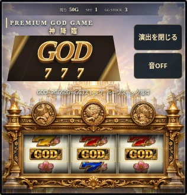

# 軌跡版の実機らしさと確認範囲

2026年11月6日。「すべて修正して」で採用した15分野の実装・検証表です。一般公開、銭接続、合流は保留。凱旋版は維持します。

| 分野 | 既存と今回の作業 | 確認状況 |
| --- | --- | --- |
| 液晶数字 | 毎ゲーム変化、停止順保持、テンパイ。確定小役に応じた最終数字の傾向と出目の分類を追加 | 実装済み |
| リール | 独自20コマ、原則4コマ/補助、全押し順。ハズレ候補分散・装飾揃い除外、回転/ブレーキ/ガラスを調整 | 実装済み |
| 通常演出 | 風/光/雷/扉の停止別反応。演出密度・反復抑制・静かなゲームを追加 | 実装済み |
| 前兆 | 公開済みの前兆区間と装飾の連続演出。段階と終息を整え、隠れた当選予定は送らない | 実装済み |
| 三神 | 左紫/中央赤/右青を金主体で維持。公開ナビ、停止、小役、前兆、当選に光と輪郭を連動 | 実装済み |
| 各区間 | GG/PGG/SGGの独自背景/BGM。開始/継続待ち/復帰/終了の表示と切替を追加 | 実装済み |
| 強当選 | GODの無音/暗転、111/777/獲得数、スキップ。確定した直前告知の再表示を追加 | 実装済み |
| 音 | 独自音、左右位置、モーター、音量抑制。接触/ブレーキ/ナビ/小役/払出し、個別ミックスとBGMフェードを追加 | 実装済み |
| 筐体 | 独自の黒金画像/樹脂/三神。反射、液晶ガラス、金属/樹脂/リールの影と圧下を追加 | 実装済み |
| ランプ | ナビ/停止/当選を区別。銘板/側面/操作台の点灯順と緩い発光を追加 | 実装済み |
| 遊技操作 | 本人/CSRF/revision/二重送信防止、Space/1/2/3。接触反応と操作の状態表示を追加 | 実装済み |
| スマホ | 44px以上、縦横/集中/復帰。安全領域、任意の対応端末振動、触覚なしの代替表示を追加 | 実装済み・実端末は別確認 |
| 長時間 | 低減/自動画質/非表示停止。音の先読み制御、タイマー取消、任意の休憩目安、限定メモリーの記録を追加 | 実装済み |
| 仕様照合 | 公開資料との対応表は[kiseki-trial.md](kiseki-trial.md)。確定値・暫定値・未照合を保持し、独自配列を実機配列とは呼ばない | 保存資料との照合済み・最新取得403 |
| 検証 | 全役/順序/入力/保存/旧版/失敗、両ブラウザー/非JS。操作時間診断、音声処理状態、出現率/収支のローカル検証を追加 | 実装済み |

## 確認の限界

- 実機の非公開制御、全演出の完全な期待度、表裏モード全振分、有利区間切れなどは、根拠がないまま推測で実装しません。遊技モデルの暫定規則は別表に残します。
- 2026年11月6日の一撃の再取得はHTTP403でした。前回保存した公開HTMLと既存の確認記録を照合し、新しく確認できたとは扱いません。実機画像・音源を転載しません。
- Chromium/WebKitの確認と、実iPhone/Androidの指の感触・実スピーカーから聞こえる時間・発熱/電池の実測は別です。
- 操作時間診断は通信/DOM/描画コールバックまでの目安で、実描画や実音声の開始を保証しません。端末の状態は画面内だけに保持し、外部へ送りません。
- 表示や音は遊技の確定・権利の条件にしません。スキップ、消音、低減、非表示、通信失敗で抽選や払出しをやり直しません。

## 再現できる確認

- 型チェック、ビルド、関連13ファイル111テストを確認。最終の全テスト結果は作業メモへ記録します。
- Chromium/WebKitで、個別音量、実際の15回払出音、3区間BGM、告知スキップ/再表示、非表示取消、409時の状態維持、非JSの3STOPを確認済みです。最終結果と実端末の区別は作業メモを参照してください。
- [資料照合記録](kiseki-source-check.json)と[固定seedのローカル結果](kiseki-model-report.json)を保存。100万抽選・3000ゲームの補助停止/タイミング停止で抽選・収支が一致しました。短期サンプルの返却率は実機の機械割ではありません。
- `npx tsx src/scripts/verify-kiseki.ts --games=3000 --draws=1000000 --mode=assist` でDB・Discord・実際の銭を使わず検証できます。

設定は端末のlocalStorageに保存します。直近の遊技記録はメモリー内120回まで、診断は20件までです。振動は初期OFFで、未対応端末では選べません。AudioContextの遅延値はブラウザーの申告値で、実際に聞こえるまでの実測値ではありません。

## 画面

